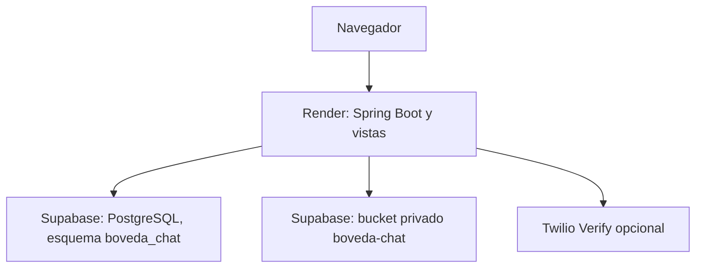

# Bóveda Chat

Conversaciones privadas y documentos en un mismo espacio. Proyecto académico en Java con frontend integrado en Spring Boot: abre una conversación, guarda un archivo en tu bóveda y decide con quién compartirlo.

Incluye mensajes y adjuntos cifrados en el servidor, verificación opcional de celular con Twilio Verify, auditoría, pruebas automáticas y configuración para Render. El registro normal funciona sin contratar SMS.

## Empieza aquí

- **Para subirlo a Render:** sigue [DESPLIEGUE_RENDER.md](docs/DESPLIEGUE_RENDER.md). Necesitas configurar tus propias credenciales una vez.
- **Para abrirlo en tu PC:** instala **JDK 21** y usa el wrapper. No necesitas Docker, PostgreSQL, pgAdmin ni Node instalados para el modo local.

```powershell
.\mvnw.cmd -v
.\mvnw.cmd spring-boot:run
```

Abre <http://localhost:8080>. Crea dos cuentas desde dos perfiles o navegadores distintos; busca la segunda por su usuario. El modo local guarda la base H2 y los archivos cifrados en `.local/`. La primera ejecución descarga dependencias de Maven y necesita internet. El primer comando debe indicar Java 21 o superior.

Para crear el administrador inicial de auditoría:

```powershell
powershell -ExecutionPolicy Bypass -File .\scripts\iniciar-local.ps1 -CrearAdmin
```

El script pregunta nombre y contraseña. No se incluyen usuarios ni contraseñas predeterminados. Las variables de administrador crean una cuenta nueva una sola vez: no restablecen contraseñas de cuentas existentes.

## Funciones

- Registro e inicio de sesión con contraseña BCrypt; celular verificado cuando activas SMS.
- Chats de dos participantes, búsqueda por usuario, historial paginado y confirmación de lectura.
- Actualización cada cinco segundos, pausada cuando la pestaña está oculta. No usa WebSocket.
- Bóveda de PDF, PNG, JPG y TXT, con detección de tipo, hasta 5 MB por archivo y 50 MB/100 archivos por cuenta.
- Compartir un archivo propio en un chat autoriza a su destinatario; conocer un UUID o una URL no concede acceso.
- Previsualización de imágenes autorizadas y descarga con nombre original.
- Retirar y restablecer acceso a adjuntos. El propietario conserva su copia; las copias ya descargadas por otra persona no se pueden retirar.
- Eliminar archivos propios que todavía no fueron compartidos.
- Auditoría administrativa de acceso, archivos, registros y solicitudes SMS. No almacena el texto de los mensajes ni los códigos OTP.
- CSRF, cabeceras de seguridad, cookies protegidas en producción y límites de intentos.

## Tecnologías

Java 21, Spring Boot 3.5.16, Spring Security, Thymeleaf, JavaScript sin framework, Spring Data JPA, PostgreSQL/H2, Flyway, Supabase Storage privado, Twilio Verify opcional, JUnit 5, MockMvc, Mockito, JaCoCo, Docker, GitHub Actions y Trivy. La versión de Spring Boot se fijó en la rama 3.5 para mantener una integración estable con estas dependencias; no es necesario conservar la 4.1 del proyecto anterior.



## Pruebas y automatización

```powershell
.\mvnw.cmd clean verify
```

Los reportes quedan en `target/surefire-reports/` y la cobertura en `target/site/jacoco/index.html`. Las pruebas no envían SMS ni usan tus proyectos Supabase: los adaptadores externos se prueban con respuestas HTTP controladas.

En GitHub Actions, cada push o pull request ejecuta pruebas con H2 y con PostgreSQL real, un recorrido de navegador de escritorio/movil, construye la imagen y genera reportes Trivy. Un hallazgo HIGH/CRITICAL con corrección disponible bloquea la comprobación de imagen; no se oculta con `continue-on-error`. El blueprint de Render espera a que las comprobaciones del repositorio pasen. Debes conectar Render a tu cuenta GitHub; el primer despliegue requiere configurar credenciales y puede iniciarse manualmente.

**Una acción verde indica que pasaron esas comprobaciones, no que la aplicación esté libre de todos los riesgos.** Los reportes y el alcance exacto están en [PRUEBAS.md](docs/PRUEBAS.md).

## Documentación

- [Despliegue en Render y conexión Supabase](docs/DESPLIEGUE_RENDER.md)
- [Verificación por celular y restricciones de SMS](docs/SMS.md)
- [Pruebas y evidencia](docs/PRUEBAS.md)
- [Seguridad y límites de la demostración](docs/SEGURIDAD.md)
- [Guía de exposición y temas del curso](docs/EXPOSICION.md)
- [Mapa de rutas](docs/API.md)

## Conserva tus datos

En local, conserva toda `.local/`, incluida la clave. En Render, conserva **BOVEDA_KEY**, los datos PostgreSQL y el bucket. Cambiar la clave no vuelve a cifrar lo existente: lo vuelve ilegible para esa clave nueva. Este proyecto empieza con datos nuevos y no importa automáticamente los documentos de la bóveda anterior.

No incluyas `.env`, claves, datos locales ni credenciales en GitHub. El ZIP de código no contiene esos datos. Para borrar cuentas o cambiar el esquema, añade migraciones: no cambies una migración que ya haya sido aplicada.
